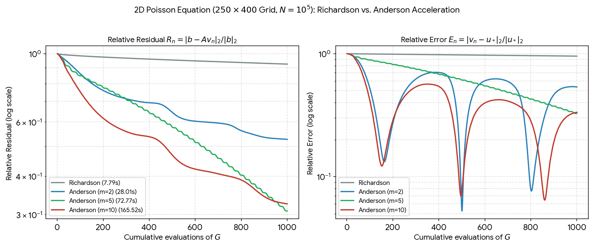

# Matrix-Free 2D Poisson Solver & Anderson Acceleration Benchmark

A lightweight, pure-NumPy numerical linear algebra benchmark comparing **Richardson iteration** against **Anderson Acceleration** ($m \in \{2, 5, 10\}$) on a large-scale 2D Poisson finite-difference system ($250 \times 400$ interior grid, $N = 10^5$ unknowns).

## Problem Formulation

We discretize the 2D Poisson equation with homogeneous Dirichlet boundary conditions on $\Omega = (0, 1)^2$:

$$-\Delta u(x, y) = 2\big(x(1-x) + y(1-y)\big), \quad u|_{\partial \Omega} = 0$$

which admits the exact solution $u_*(x, y) = x(1-x)y(1-y)$. Using a 5-point stencil without assembling a dense $N \times N$ matrix, we solve $Av = b$ via:
- **Richardson Iteration**: $v_{n+1} = G(v_n) = v_n + \tau(b - Av_n)$ with $\tau = (2/h_x^2 + 2/h_y^2)^{-1}$.
- **Anderson Acceleration ($m$)**: Extrapolates the most recent $q = \min(m, n)$ fixed-point residuals by solving an $N \times q$ least-squares subproblem at each step.

## Numerical Results ($N = 100{,}000$, Budget = 1,000 Evaluations of $G$)

| Method | Final Relative Residual $R_n$ | Final Relative Error $E_n$ | Evaluations | Runtime (s) |
| :--- | :---: | :---: | :---: | :---: |
| Richardson Iteration | `9.254e-01` | `9.565e-01` | 1,000 | 7.79 |
| Anderson ($m=2$) | `5.269e-01` | `5.367e-01` | 1,000 | 28.01 |
| **Anderson ($m=5$)** | **`3.083e-01`** | **`3.274e-01`** | **1,000** | **72.77** |
| Anderson ($m=10$) | `3.251e-01` | `3.340e-01` | 1,000 | 165.52 |

*(Verification on a $12 \times 18$ grid confirms $\|Au_* - b\|_2 / \|b\|_2 = 9.93 \times 10^{-15}$ and exact equivalence between Richardson and Anderson $m=0$.)*



## Key Observations

1. **Significant Acceleration**: Within 1,000 operator evaluations, standard Richardson iteration barely reduces the residual (`0.925`), whereas Anderson Acceleration ($m=5$) cuts both residual and error to `~0.31`.
2. **History Length Trade-off**: Increasing $m$ from 5 to 10 degrades both accuracy (`0.308` vs `0.325`) and speed ($2.3\times$ slower) due to growing least-squares overhead and ill-conditioning of the residual difference matrix $\Delta R_n$.
3. **Residual–Error Decoupling**: While $R_n$ decreases steadily, $E_n$ exhibits non-monotonic oscillations for $m=2$ and $m=10$. Because the 2D discrete Laplacian is severely ill-conditioned ($\kappa_2(A) \sim O(N)$), minimizing the residual primarily damps high-frequency modes while low-frequency error components can still fluctuate.

## Usage

```bash
pip install -r requirements.txt
python poisson_anderson.py
```
